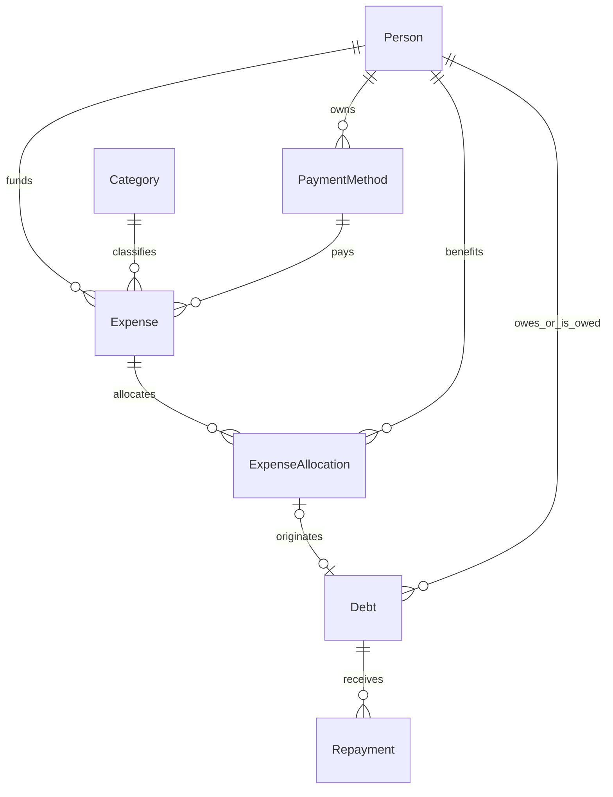

# Together Finance database architecture

## Scope and boundaries

The database stores financial people, not authentication accounts. Antonella, Marco, and external people such as a parent can be debtors, creditors, funders, or beneficiaries. POV never supplies these identities. Every financial operation must explicitly select stable person IDs. Shared-password authentication uses separate process-local sessions without changing this schema. Protected expense/reference endpoints now reuse this schema; see [expenses-api.md](expenses-api.md). Loan/repayment endpoints remain a future stage.

The initial migration is `20261031170000_initial_financial_schema`. Before application, read-only inspection confirmed both Neon connections worked and there were no application tables, migrations, custom types, routines, or extra schemas. The reviewed migration creates seven application tables, four enums, restrictive foreign keys, indexes, and checks. It inserts no business data. Post-migration verification found all seven tables empty.

## Models and relations

| Prisma model / SQL table | Responsibility |
| --- | --- |
| `Person` / `people` | Stable UUID, display name, optional notes, active status, audit timestamps. No credentials or authentication role. |
| `Category` / `categories` | Name, description, active status, audit timestamps. A SQL unique expression index on `lower(btrim(name))` prevents case/space duplicates. |
| `PaymentMethod` / `payment_methods` | Name, type, optional owner, description, active status, audit timestamps. Types: cash, bank transfer, credit card, debit card, other. No full card numbers, CVV, PIN, or banking credentials. |
| `Expense` / `expenses` | Amount, PEN currency, purchase date, merchant, description, category, payment method, explicit funder, personal/shared classification, audit/deletion timestamps. |
| `ExpenseAllocation` / `expense_allocations` | One explicit beneficiary per expense/person pair, percentage and exact monetary share, audit/deletion timestamps. |
| `Debt` / `debts` | One canonical obligation: debtor, creditor, original principal, currency, incurred/due dates, description, origin, optional unique allocation source, audit/deletion timestamps. |
| `Repayment` / `repayments` | Amount paid toward one debt, payment date, description, audit/deletion timestamps. Currency is inherited from the debt. |



An independent **loan is a `Debt` with origin `LOAN`**, not a second Loan table. Its creditor is the lender, its debtor is the borrower, and it has no expense source. This avoids storing the same principal, parties, currency, dates, and soft-deletion lifecycle twice. Deleting/restoring that debt is deleting/restoring the independent loan.

An expense debt has origin `EXPENSE` and exactly one allocation source. The allocation's beneficiary is its debtor; the expense's explicit funder is its creditor; the debt principal equals the allocation amount. A beneficiary funding their own share creates no debt. The unique allocation link prevents multiple obligations for that same share, including soft-deleted duplicates. A cash or card method's owner is metadata and must never silently supply the funder.

## Monetary precision and dates

- Money uses PostgreSQL `NUMERIC(14,2)`: up to `999999999999.99`. All supported money is initially PEN. No cross-currency conversion or aggregation exists.
- Percentages use `NUMERIC(7,4)` and must be greater than zero and at most 100. Totals must be exactly 100. A person with no economic share should not receive a zero-percent allocation.
- Accept decimal strings or Prisma Decimal values in the domain layer, never JavaScript floating-point money. Check input scale before persistence: PostgreSQL fixed-scale numerics round extra decimals before a row CHECK can inspect them.
- Allocation amounts may be zero when a positive percentage of a very small expense rounds below one cent. Do not create a zero-principal debt for that share.
- Allocation uses largest-remainder apportionment in integer cents: floor each exact proportional share, then distribute remaining cents by descending fractional remainder. Stable person IDs resolve equal remainders, independently of array order, names, or POV. Persist the final exact amounts as well as percentages.
- The existing frontend is still an independent prototype. Future API integration must align its rounding display with this backend policy; it currently gives odd-cent ties to Antonella.
- Purchase, loan-incurrence, repayment, and due dates use PostgreSQL `DATE`. Exchange them as `YYYY-MM-DD`; use explicit UTC-midnight conversions for Prisma date-only values rather than shifting a calendar date through local timezones.
- Audit and deletion timestamps use `TIMESTAMPTZ(3)`. UUIDs are generated by Prisma. `updatedAt` is maintained by Prisma; manual SQL maintenance must set it explicitly.

## Financial rules and examples

1. A personal expense of S/ 150 funded by Marco for Antonella has one 100% allocation to Antonella and one expense-origin debt from Antonella to Marco for S/ 150.
2. A S/ 100 dinner funded by Marco and split 50/50 has two allocations of S/ 50. Only Antonella's share creates a debt to Marco.
3. A S/ 200 expense split 70/30 has exact allocations of S/ 140 and S/ 60. Which share creates a debt depends on the explicitly selected funder.
4. A parent lending Antonella S/ 300 creates one loan-origin debt for S/ 300. There is no expense or allocation.
5. A S/ 60 repayment against a S/ 150 debt leaves S/ 90 outstanding. It creates no new expense or second debt.

Spending totals come from active expenses/allocations. Outstanding obligations come from active debts and repayments. Never add loan/debt principal or repayments to expense totals, or generate both a loan and a debt row for one obligation. Do not automatically net opposite-direction debts: A owing B S/ 100 and B owing A S/ 30 remain two obligations.

For an effectively active debt:

`outstanding = original principal - sum(active repayments for this debt)`

Status is derived as `OPEN`, `PARTIALLY_REPAID`, or `PAID`. Effective inactivity produces `INACTIVE` with zero contribution to active paid/outstanding totals while preserving the original principal and stored history. No balance or debt-status column is stored. A due/overdue display can be derived from dates later.

## Soft deletion and restoration

Financial rows (`Expense`, `ExpenseAllocation`, `Debt`, `Repayment`) have independent nullable `deletedAt` timestamps. No delete hook cascades flags or permanently deletes data.

- An allocation is effectively active only when it and its expense are not deleted.
- An expense debt is effectively active only when the debt, source allocation, and source expense are not deleted.
- A loan-origin debt is effectively active when its own deletion flag is null.
- A repayment contributes only when it and its debt/source chain are effectively active.
- Deactivating a person, category, or payment method removes it from future selection; it does not erase historical financial contributions.

Deleting a parent leaves child timestamps untouched. Restoring it re-enables eligible children, while independently deleted children stay deleted. This avoids losing which rows were separately deleted. Every restoration must revalidate source consistency and outstanding amounts; restoring an old repayment may cause an overpayment and must then be rejected. Unique expense/person and debt/source links remain reserved after deletion: restore/revalidate the existing row instead of creating a second history link.

All ten foreign keys use `ON DELETE RESTRICT` and `ON UPDATE RESTRICT`. Physical deletion is not implemented. Permanent deletion needs a separately reviewed future workflow. Soft deletion is not an immutable audit log or full revision history.

## What PostgreSQL enforces

- Primary keys, foreign keys, unique expense/person and debt/source links, exact numeric storage, and PEN currency enums.
- Case-insensitive, space-trimmed category-name uniqueness through a SQL expression index.
- Twelve CHECK constraints: nonblank names/merchant, positive finite expense/debt/repayment amounts, nonnegative finite allocation amounts, percentage range, different debtor/creditor IDs, origin/source nullability consistency, and due date not before incurrence.
- Every foreign-key column has an index or a covering index prefix. History/active queries also have date/deletion indexes.

Prisma cannot express the expression index or these CHECK constraints directly in `schema.prisma`; their reviewed SQL migration is authoritative. Preserve them when creating future migrations and never replace the migration with `db push`.

## Invariants requiring transactional services

The pure helpers validate financial examples, but do not execute writes or establish transaction safety themselves. Expense services now reuse them inside short serializable interactive transactions, with bounded whole-operation retries. These services and future financial writers must enforce the following:

1. Resolve explicit, existing, eligible people/category/method IDs. A POV value is never a financial default.
2. Validate unrounded money and percentages before PostgreSQL coerces their scale.
3. Personal classification requires one beneficiary; shared requires at least two. Active amounts must sum exactly to the expense, percentages to 100, and individual amounts must follow the rounding policy.
4. Create/update the expense, allocations, and exactly the required non-self debts atomically. Verify each debt's debtor, creditor, principal, currency, and incurrence date match its source. The FK and origin CHECK alone cannot enforce these cross-row facts.
5. Before inserting, updating, or restoring a repayment, lock/reload the relevant active source chain and debt, sum current active repayments, and reject an amount above the remaining balance. Exclude the replaced row when validating an edit; never exclude another debt's rows accidentally.
6. Apply the same concurrency discipline to all source edits, deletion/restoration, and repayment writers. Lock source expenses, allocations, then debts in a consistent order, sorting multiple IDs. Alternatively, consistently use serializable interactive transactions with bounded retries for Prisma `P2034` conflicts. Do not rely on a prior out-of-transaction balance read.
7. Reject financial source/principal changes with repayment history until an explicit correction/revision workflow exists. No silent rewrite of settled obligations is allowed. Recheck all child invariants before restoring a parent.

No database trigger currently serializes repayments or enforces allocation aggregates. Unit/API tests do **not** prove concurrent write safety. Expense/reference writes use the serializable transaction boundary; future repayment writers must follow it too. Tests verify retry/rollback/revalidation expectations with mocks. Real integration/concurrency tests need a separate disposable database, never fake financial rows in the live database.

## Prisma 7 configuration and lifecycle

- `prisma.config.ts` configures schema/migrations and the direct CLI connection. The schema datasource contains only its PostgreSQL provider, not obsolete Prisma 6 URL fields.
- The `prisma-client` generator writes ESM TypeScript under `src/generated/prisma` with `.js` imports. It is ignored by Git, generated before build/development startup, and compiled by Nest to `dist/generated/prisma`.
- `PrismaModule` exports one default-scope `PrismaService`. It owns an adapter-pg connection pool (maximum three connections, 15-second connection timeout), connects on module initialization, and disconnects on teardown. No client is created per request.
- Canonical variables: `DATABASE_URL` is pooled runtime; `DIRECT_URL` is direct CLI/migrations. Runtime does not require the direct credential. Generation/validation do not require connecting to a database.
- Compatibility: if `DIRECT_URL` is absent and `DATABASE_URL_POOLED` exists, the existing `DATABASE_URL` is treated as direct and `DATABASE_URL_POOLED` as runtime. This mapping never changes `.env` or `process.env`. Explicit canonical configuration takes precedence.
- Neon URLs require TLS. Certificate verification is never disabled. Pinned pg 8 emits a compatibility notice for the existing `sslmode=require`; it currently verifies certificates fully. Review TLS semantics before any future pg major upgrade.
- Local `.env` is ignored and was not edited. Example connection variables are blank. No database values belong in frontend configuration, logs, documentation, tests, or Git.

## Commands and migration procedure

Run from `backend/`:

```sh
npm ci
npm run prisma:validate
npm run prisma:generate
npm run db:inspect
npm run prisma:migrate:status
npm run build
npm run lint
npm test
npm run test:e2e
```

The checked-in wrapper redacts database URLs and identifying components from Prisma CLI output. Prefer the provided commands when capturing logs.

The initial migration was generated offline with `node scripts/safe-prisma.mjs migrate diff --from-empty --to-schema prisma/schema.prisma --script --output prisma/migrations/20261031170000_initial_financial_schema/migration.sql`, then reviewed and augmented with the checks, category index, and transactional empty-database guard. It was applied with `npm run prisma:migrate:deploy` only after a second successful `node scripts/database-inspect.mjs --require-empty` check. No shadow database, reset, forced push, seed, or hard deletion was used.

For a new empty installation, repeat connectivity/object inspection and SQL review before deployment. The guard refuses existing application objects. On an existing installation, do not reuse `--from-empty` to replace history: prepare a new reviewed migration, back up first, inspect current status/data, and apply only approved forward changes. Never modify an already applied migration file or its checksum. Do not run migrations on every API boot.

For read-only verification after a build, `node scripts/database-verify.mjs --expect-empty` checks the initial schema/history, constraints, indexes, and pooled Prisma reads. Omit `--expect-empty` once real data exists; update the initial-schema assertions as the architecture evolves. `node scripts/smoke-api.mjs` starts and closes a temporary compiled API on an ephemeral port and checks startup/health without disturbing another local server.

## Backup and recovery

Before future schema changes or financial corrections, take a verified logical backup and inspect the current Neon console's available recovery window; do not assume a Free-plan retention duration is permanent. Store encrypted backups outside Git with restricted access. Use PostgreSQL tools with a protected password/service file rather than exposing secrets in command arguments or logs. A migration directory backs up schema evolution, not financial data.

Restore a backup first into an isolated database/branch, verify migration history, FK/CHECK/index definitions, monetary totals, and soft-deletion chains, then plan an explicit cutover. Do not run reset, destructive SQL, or automatic restore against the live application database. No backup restore or destructive command was executed in this task.

## Validation and remaining work

Initial validation: schema valid; Prisma Client 7.10.1 generated; migration applied and up to date; all seven business tables empty; ten restricted/indexed FKs; twelve CHECKs; category expression index present; pooled Prisma reads successful; Nest startup/health HTTP 200 successful. Tests cover allocation and debt rules in isolation; API tests mock Prisma and do not read local Neon.

Shared authentication and transactional expense/reference endpoints are implemented without additional schema changes. Loan/repayment endpoints, correction history, runtime least-privilege role provisioning, and real PostgreSQL concurrency verification remain future work. The frontend is unchanged. Expense validation uses mocks and created no live records; it did not independently verify Neon branch identity. No existing database data was deleted.
