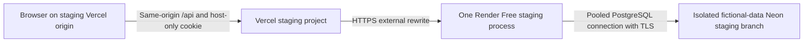

# Isolated staging deployment preparation

Prepared on November 1, 2026, on `feat/staging-deployment`. **No account was connected, service/project/branch created, application deployed or existing Neon database accessed.** All cloud setup, hosted tests and migration execution below remain pending explicit authorization. Importing a project or creating a Blueprint can start an initial deployment; disabling later automatic deployments does not make initial creation a read-only action.

This is a staging-only configuration for fictional financial records. It is not a production release. Continue to follow [production readiness](production-readiness.md), [backup/restore](backup-restore.md), [authentication](authentication.md) and [the final quality audit](final-quality-audit.md).

## Architecture and isolation boundaries



Use a separate Vercel project and Render service whose names contain the hyphen-separated word `staging`. Use their default `vercel.app` and `onrender.com` hostnames for this initial procedure. Custom domains require a separately reviewed update to the origin checks; do not bypass those checks. A dedicated fictional-data Neon project is the preferred isolation boundary, with its own child staging branch, endpoints and credentials.

The committed Vercel destination uses the reserved `.invalid` domain. It is intentionally unusable, and its guarded build refuses to run until the operator edits the single rewrite to the independently reviewed Render staging origin. No environment interpolation is assumed inside `vercel.json`. The preflight also checks same-origin API configuration, the dedicated frontend project, disabled automatic deploys and API cache controls. It rejects obvious production-like targets, recursive Vercel destinations and drift between the rewrite and its public environment pin.

The backend staging startup check requires the exact pooled Neon endpoint/database to match independent direct-host/database pins, an explicit fictional-data acknowledgement, canonical variable names, production HTTPS cookie settings and one exact frontend Origin. These are refusal guards against configuration mistakes, **not cryptographic proof of Neon branch identity or contents**. An operator must independently verify ownership, endpoint-to-branch mapping, fictional-only ancestry and separation from development/production in the provider consoles. Never derive the pins by simply parsing the URL being checked.

## Prepared files and commands

| Component | Configuration |
| --- | --- |
| Vercel root directory | `frontend` |
| Vercel configuration | `frontend/vercel.json` |
| Frontend runtime | Node major 24, pinned by package engines and matching lockfile metadata |
| Frontend install | `npm ci --include=dev` |
| Frontend hosted build | `node scripts/check-staging-config.mjs && npm run build` |
| Frontend output | `dist`, relative to `frontend` |
| Render Blueprint path | `render.staging.yaml`, relative to repository root; it is not the default `render.yaml` |
| Render root directory | `backend` |
| Backend runtime | Node 24; the Blueprint pins the locally tested patch |
| Backend build | `npm ci --include=dev && npm run build` |
| Backend start | `npm run check:staging && npm run start:prod` |
| Backend health path | `/api/health` |
| Schema deployment | Separate reviewed operator action, never build/start/pre-deploy/initial-deploy hooks |

`npm run build` in the backend already runs `prisma:generate` through `prebuild`. Generation and validation do not require a live database. The application validates its port, exact HTTPS CORS origins, scrypt hash format, independent signing secret, cookie policy, session duration and proxy setting during bootstrap. It binds Render's supplied `PORT` on `0.0.0.0`; the local default remains available. Startup connects Prisma but does not migrate or seed. Health is a public liveness endpoint, not a continual database-readiness test.

The ordinary frontend `npm run build` remains available for local development and CI. The stricter hosted staging command currently fails by design because no real staging hostname has been configured. Do not remove the preflight to get a green cloud build.

## Required environment variable names

Enter secrets only through the hosting environment or a trusted private operator process. The following inventories contain names and purposes, not credentials or real deployment values. Public origin/identity pins are not secrets. Existing examples contain only non-sensitive policy defaults/placeholders.

### Vercel project environment

| Name | Purpose |
| --- | --- |
| `VITE_API_URL` | Same-origin API path, as specified in the frontend example; never an absolute backend URL for this topology |
| `STAGING_RENDER_ORIGIN` | Exact independently reviewed HTTPS staging service origin matching the literal rewrite |
| `STAGING_FRONTEND_ORIGIN` | Exact stable HTTPS origin of the dedicated staging Vercel project |
| `VERCEL`, `VERCEL_PROJECT_PRODUCTION_URL` | Provider system metadata used to reject an unexpected project; enable exposure of system environment variables |

Vercel needs **no database URL, password hash, password, signing secret or CSRF token**. Anything prefixed with `VITE_` can be embedded in the public bundle.

### Render service environment

| Name | Purpose |
| --- | --- |
| `NODE_VERSION`, `NODE_ENV` | Reviewed runtime and production security mode, supplied by the Blueprint |
| `PORT` | Supplied by Render; do not override it in this procedure |
| `DATABASE_URL` | Pooled TLS connection to the isolated staging branch, using a staging-only runtime role |
| `SHARED_PASSWORD_HASH` | Newly generated staging-only scrypt hash |
| `SESSION_SECRET` | Independently generated staging-only signing secret |
| `SESSION_TTL_SECONDS`, `SESSION_COOKIE_SAME_SITE` | Existing duration and secure same-origin cookie policy, initially supplied by the Blueprint |
| `TRUST_PROXY_HOPS` | Safe default from the Blueprint; change only after verifying both public ingress paths |
| `CORS_ORIGINS` | Only the exact stable staging frontend origin |
| `STAGING_FRONTEND_ORIGIN` | The same independently reviewed frontend origin |
| `STAGING_EXPECTED_DATABASE_HOST` | Exact **direct** staging Neon hostname independently checked in the console; the guard derives the corresponding pooler hostname |
| `STAGING_EXPECTED_DATABASE_NAME` | Exact staging database name independently checked in the console |
| `STAGING_DATABASE_CONFIRMED` | Explicit acknowledgement that this new branch contains fictional data only; use the guard's `fictional-only` acknowledgement after inspection |

Do not set `DIRECT_URL`, the legacy `DATABASE_URL_POOLED`, migration approvals, plaintext password configuration, Vercel/GitHub/Neon access tokens or disposable-test variables on the running service. Full authentication/environment validation remains in the unchanged application bootstrap after the staging check. The staging check itself does not load a local `.env` or connect to a database.

### Separate migration operator process

Required names: `DIRECT_URL`, `MIGRATION_TARGET`, `MIGRATION_EXPECTED_HOST`, `MIGRATION_EXPECTED_DATABASE`, `MIGRATION_APPROVED`, `STAGING_EXPECTED_DATABASE_HOST`, `STAGING_EXPECTED_DATABASE_NAME`, `STAGING_DATABASE_CONFIRMED`. Select the explicit staging target only after the review described below. The migration-specific pins and staging pins must both match the direct connection. Do not export these variables into CI or the long-running service.

## Manual cloud setup sequence — not executed

Every step in this section requires future authorization. Obtain the exact owned hostnames from the consoles; do not guess a URL from a requested service name. Keep a private record of resource identity, region, reviewed revision and test results without passwords, connection strings, cookies or tokens.

### 1. Create a new fictional-only Neon staging branch

1. Check the account's actual plan, project/branch allowance and budget. Prefer a **new empty staging project** in a region near the future Render service. Do not import, clone, reset, restore or connect a real financial database. Creating a separate project also separates staging from production resource usage and credentials.
2. In that new project, leave its initial root branch empty. Open **Branches → New branch**, select that empty root as the parent and create a clearly named staging child branch. A normal data-and-schema branch from an empty parent contains no real records. Independently verify its branch ID, endpoint IDs, database name and ancestry. Do not modify an existing development or production branch.
3. Obtain the new staging branch's pooled runtime and direct migration connections privately. Use unique staging runtime and migration credentials, TLS, and appropriate least-privilege runtime versus schema-owner permissions. Do not change production roles or reuse development/production secrets. Runtime access needs the application's required DML, not schema deployment privileges.
4. Record the direct host and database pins independently from the branch's console metadata. Ensure neither endpoint is one of the development or production endpoints. Set the fictional-only acknowledgement only after this inspection.
5. Apply the existing migration to this **new** staging branch through the guarded operator procedure below, after authorization. Do not insert data automatically at build or startup. Future authorized testers may create clearly marked fictional examples through the existing authenticated UI, including synthetic personal/shared expenses, a loan and repayments. Never copy personal financial data, production CSV exports or actual production backups into staging.

An alternative is a child of an independently verified **fictional-only** fixture branch whose migration history is already correct. Ordinary Neon branching copies parent data as well as schema; never assume the branch name makes a production-derived copy safe. Neon also offers [schema-only branching](https://neon.com/docs/guides/branching-schema-only), but copying existing objects without Prisma migration-history rows requires a separate baselining review. This runbook does not bypass the migration guard with `migrate resolve`, database push or manual history insertion.

If limits prevent a new empty project or a fictional-only branch, stop for an explicit resource/budget decision. Do not delete an existing branch, replace a database, silently upgrade the plan or use a real-data parent as a shortcut.

### 2. Prepare fresh staging authentication and migrate separately

Generate new staging credentials using the existing interactive setup helper in a **new, private, empty working directory**, invoking `backend/scripts/setup-auth.mjs` by its absolute path with Node. It writes `.env` in the current directory and takes the password through hidden input. Do not run it from the ordinary backend directory for this task, print its output file, pass passwords as arguments or rotate development/production credentials. Transfer the two generated settings privately into Render's secret inputs and protect/remove the temporary file according to local storage policy.

For migrations, use a separate clean operator checkout/process with no ordinary development `.env`. Install with `npm ci --include=dev` from `backend/`. Load only the approved staging direct URL, both sets of independently verified pins and explicit staging/review/fictional-data acknowledgements through protected input. Clear them when the process ends. The guarded wrapper redacts database identifiers from Prisma output; do not enable shell tracing or dump the environment.

Before any write, inspect the initial SQL `20261031170000_initial_financial_schema`, confirm the target is the newly created staging branch and review recovery arrangements. For future changes to a populated staging branch, follow the encrypted backup/rehearsal rules in [backup-restore.md](backup-restore.md). Then, **only after authorization**, from `backend/`:

```text
npm run prisma:validate
npm run prisma:migrate:status
npm run prisma:migrate:deploy
npm run prisma:migrate:status
```

The first status command can report unapplied migrations on a new empty branch. Investigate unexpected existing objects, failures or migration-history drift instead of forcing a baseline/reset. The existing deploy guard now accepts `staging` with all previous exact host/database, direct TLS and reviewed-approval requirements plus the additional staging pins/acknowledgement. It still rejects resets, arbitrary flags and database push. No migration file or schema was added by this task, and none of these commands was run against Neon.

### 3. Configure the Render Free service

1. Once authorized, create a dedicated staging Web Service/Blueprint from the reviewed repository revision. For a Blueprint, explicitly choose `render.staging.yaml` as its path. Its configured source branch is `develop`; use only a revision the user has reviewed/merged and CI has validated. This preparation does not create or merge that revision.
2. Verify **Node runtime**, **Free plan**, **one instance**, **root directory `backend`**, the exact build/start commands above, and **health path `/api/health`**. Before creation, add an explicitly reviewed `region` field to the Blueprint if its provider default is not close to staging Neon. Keep automatic deploys **Off**. Blueprint creation can still initiate the first deployment.
3. Populate every `sync: false` entry from the isolated staging environment. Confirm the pins and canonical pooled connection again. Do not add a direct URL to the runtime. Render provides the port. Do not add migration/seed/pre-deploy/initial-deploy commands, disks or paid add-ons.
4. Record the actual owned HTTPS `onrender.com` URL, including any provider-added suffix. It must retain a staging word in its service hostname. This is the origin to review for the Vercel pin and literal rewrite.
5. Verify direct HTTPS health once deployment is separately authorized. Startup must refuse mismatched pins, wrong CORS/cookie mode or missing authentication secrets. Do not bypass the startup check to troubleshoot a misconfigured environment.

### 4. Configure the dedicated Vercel staging project

1. Once authorized, create/import a **separate project** with a staging name and the stable default hostname used in the origin pins. Do not link the real production project or reuse its environment. Review account/private-repository eligibility before import. Import/build is a cloud action, not a validation command performed by this task.
2. Set **Root Directory `frontend`**, **Framework Vite**, **Node major 24**, the exact install/build commands above and **Output Directory `dist`**. `vercel.json` is read relative to that root. See [Vercel Node version selection](https://vercel.com/docs/functions/runtimes/node-js/node-js-versions).
3. Set the three project environment names from the inventory for the stable staging deployment target. Enable Vercel system environment variables so its project hostname can be cross-checked. Vercel may call this dedicated project's stable target **Production**; that provider label does not make it Together Finance production. Never promote into a different real production project.
4. Replace only the `.invalid` rewrite origin in `frontend/vercel.json` with the independently verified owned Render staging origin, retaining the `/api/:path*` path on both sides. Set its matching public pin separately. Have the user review this non-secret configuration change before any deployment. Arbitrary preview URLs are deliberately not auto-allowlisted; a new frontend origin requires a separate exact-origin review in both services.
5. Keep `git.deploymentEnabled` false and automatic Git deployment integration disabled in project settings. Deploy only a specifically reviewed revision after explicit authorization and a green CI result. No account link, CLI login, token, deploy hook or deployment workflow was created here. Ignore local `.vercel/` metadata.

The app uses hash routes, so there is no catch-all rewrite to `index.html`. `/api` must not fall back to HTML or point back to Vercel. [External rewrites](https://vercel.com/docs/routing/rewrites) are not cached by default; this config additionally sets no-store for browser/CDN layers and does not enable rewrite caching. Preserve upstream no-store/private headers, cookie headers, status codes, query strings and CSV attachment bytes. Frontend CSP allows its same-origin API and local assets, including chart style attributes, without allowing inline scripts. Test CSP enforcement on the hosted build; do not weaken it to support a development toolbar.

## Cookies, CSRF and proxy trust

**The current cookie design is compatible with this topology provided the proxy preserves the required headers.** The browser receives a host-only cookie on the Vercel HTTPS origin because that is the origin it requested. The API sets no Domain attribute, so no cookie-domain rewrite is needed. Production mode retains the `__Host-` name, Secure, HttpOnly, Path `/`, absolute expiry and SameSite=Lax. Browser requests stay same-origin, avoiding reliance on third-party cookies between unrelated default hosting domains. Real cookie acceptance remains a pending hosted browser check; no fallback to localStorage tokens or insecure cookies is permitted.

Nest's existing CSRF guard compares the request's **Origin** to the exact allowlist and validates the session-bound `X-CSRF-Token` for unsafe methods, including login/logout. It does not infer trust from the request Host, forwarded host, POV or CORS alone. Vercel must preserve the frontend Origin, Cookie and CSRF/content-type headers and return Set-Cookie unchanged. Changing the upstream Host for routing does not justify replacing Origin with the Render origin or accepting a wildcard. Missing, `null` and unauthorized origins must fail even with an otherwise valid cookie/token.

`TRUST_PROXY_HOPS` initially trusts no forwarded client IPs. This is safe against spoofed forwarding headers but can group users behind an edge address and make the existing per-IP login limit stricter. After authorization, verify both browser → Vercel → Render and direct client → Render paths before selecting a supported trust policy. A fixed number of hops that is correct for only one path can expose spoofing. Do not guess, trust all proxies, remove global limits or weaken CSRF for convenience. Keep one backend instance; restart/redeploy/suspension loses process-local sessions and rate limits, so re-login is expected. No persistent store was introduced.

## Expected public HTTPS endpoints

These are symbolic placeholders, not configured or contacted hosts:

| Endpoint | Expected result |
| --- | --- |
| `https://<owned-staging-project>.vercel.app/` | Spanish login/app, three preserved POV identities |
| Same frontend origin + `/api/health` | JSON with `status` and `application`, no-store |
| Same frontend origin + `/api/auth/session` | Anonymous or authenticated session view, no-store, HttpOnly cookie handled by browser |
| Same frontend origin + `/api/auth/login` | POST with allowed Origin, JSON, current anonymous cookie and CSRF token |
| Same frontend origin + `/api/auth/logout` | Protected POST; successful revocation returns 204 |
| Same frontend origin + existing financial/export/bin paths | Existing authorization/CSRF rules and API contract |
| `https://<owned-api-staging>.onrender.com/api/health` | Same public liveness JSON; no financial access without valid authentication |

No endpoint URL contains a database connection, password, token or signing key.

## Hosted verification checklist — all pending

Use only the newly authorized fictional-data staging environment. Privately record pass/fail and sanitized status codes/flags, not raw cookies, CSRF values, passwords, database URLs, HAR files or sensitive screenshots. A cookie jar or replay check, if needed, stays transient in a trusted process; never put values in command arguments/history, Actions logs or artifacts.

| Check | Required evidence | Status |
| --- | --- | --- |
| Identity and TLS | Both owned staging hostnames, valid HTTPS, correct Neon branch/role, no development/production endpoint reuse | Pending authorization |
| Proxy health/routing | JSON, correct prefix/query routing, API misses remain API errors rather than HTML, no recursion/redirect to another origin | Pending authorization |
| Cookies/bootstrap | Browser stores production cookie on frontend host; Secure/HttpOnly/Lax/Path, no Domain; JS cannot read it; anonymous bootstrap rotates on login | Pending authorization |
| Shared password | Wrong password rejected; valid login opens private UI only after session confirmation; no automatic login retry | Pending authorization |
| Restoration and POV | Refresh restores session; POV persists independently; switching POV never writes ownership/payer information | Pending authorization |
| Financial requests | Authenticated reads, fictional create/edit with explicit roles, correct allocations/totals, no duplicates after double-click/retry; no loan/repayment counted as spending | Pending authorization |
| Logout/revocation | UI closes after confirmed 204, refresh stays logged out, transient replay of old session is denied | Pending authorization |
| Expiration | Temporarily use the existing short supported TTL only in staging, re-login, wait for expiry, verify private requests fail and drafts recover safely; restore normal policy afterward | Pending authorization |
| CSRF | Unsafe requests with missing/forged tokens or unauthorized/missing/`null` Origin fail; valid same-origin request succeeds; test direct Render ingress too | Pending authorization |
| Proxy/IP/rate limits | Preserve allowed Origin and reject spoofed forwarded-header attempts on both paths; verify per-IP/global limits and Retry-After without aggressive load | Pending authorization |
| Caching and CSV | No-store on public/auth/private/error responses; no CDN hit or shared financial response; UTF-8 CSV bytes, attachment headers, cancellation and limits survive proxying | Pending authorization |
| Cold start/errors | After genuine idle spin-down, waking UI, finite read attempts, manual reconnect after timeout; no fabricated zeroes or automatic mutation retry | Pending authorization |
| Restart | Authorized manual backend restart invalidates old sessions and resets process-local counters; financial records remain intact; re-login works | Pending authorization |
| Browser/CSP | Safari/iOS, Chromium/Android and desktop; no third-party-cookie exception needed, CSP permits required assets/requests, keyboard/reduced-motion and required widths remain usable | Pending authorization |
| Failure recovery | Simulated offline/timeout and uncertain fictional creation require safe explicit inspection/retry with stable UUID; no false success notification | Pending authorization |

Browser timeouts and Vercel/Render upstream timeouts may end a cold-start attempt before the service wakes. The existing bounded read attempts and manual reconnect are the intended recovery; do not add keep-alive polling, unlimited retries or blind mutation retries. Measure the hosted behavior instead of claiming that the configured timeout guarantees first-attempt success.

## Controlled delivery and rollback

The existing `.github/workflows/ci.yml` is unchanged: PR/push validation on `develop`/`main`, independent frontend/backend jobs, read-only permissions, Node 24, lockfile caches, tests and disposable PostgreSQL. New test files join its existing glob patterns automatically. It has no deployment secrets or deployment job.

After future user review, require green **Frontend** and **Backend** checks on the selected revision. Protect `main` with required PR review/status checks and restrictions on direct pushes as the repository's plan permits; configuring hosted branch protection is still pending. Keep staging provider auto-deploys off and leave real production integrations unconnected. A later automated staging workflow should require an approved environment/manual dispatch, a reviewed revision and staging-only secrets; do not add it during preparation. Never upload environment files, cookie jars, backups or financial exports as CI artifacts.

On a staging failure, stop testing and preserve the sanitized incident record. Suspend the staging service if needed, then manually select the last verified compatible backend revision and previous frontend deployment **within the dedicated staging projects**. Recheck all current environment pins and cookie/CORS settings; frontend rewrites are baked into a deployment. A backend restart or credential rotation requires re-login. Provider rollback retention is limited, so keep the reviewed revision IDs independently.

Code rollback is not a database down-migration. Never reset, force-push schema, delete records or overwrite an existing branch to recover a staging run. If database recovery is needed, use the existing isolated backup/restore process and a separately authorized **new** staging target with reviewed pins/credentials. Preserve the affected branch; do not delete it to free quota automatically. Schema compatibility and data reconciliation require review before resuming writes.

## Free tiers, costs and remaining release gates

Provider limits were checked against official documentation during preparation and can change. Check the actual account before creation; no upgrade, paid add-on, card entry or new account connection was performed.

- [Render Free](https://render.com/docs/free): idle spin-down after 15 minutes, roughly a minute to wake, ephemeral local files, shared monthly free-hour allowance, no Free one-off job/shell facility and limited rollback retention. Usage such as outbound traffic/build minutes and paid upgrades can incur costs or suspension depending on the account. Do not keep the service awake artificially or store backups on its filesystem. Measure the existing scrypt/Prisma memory requirements; do not weaken hashing to fit a plan.
- [Neon plans](https://neon.com/docs/introduction/plans): the documented Free branch allowance is currently 10 per project; additional Free branches beyond the allowance are unavailable. Compute/storage/transfer and short restore-history limits also apply. Paid branch/compute/storage overages can cost money. Pause for a budget decision if the real account has no safe capacity; never delete or reset an existing branch as a workaround.
- [Vercel plans](https://vercel.com/docs/plans/hobby): confirm personal/non-commercial eligibility, private-repository access, build/traffic/proxy limits and any account spending controls. A staging-only project does not imply unlimited free usage. Do not activate automatic production deployment, paid protection features, analytics or uptime services as part of this preparation.

Production release still requires verified hosted authentication/proxy/IP behavior, real-device and assistive-technology checks, least-privilege production roles, encrypted independent backups with a real-data isolated recovery drill, a reviewed migration/rollback operator and CI execution on GitHub. Accept the single-process restart/logout limitation explicitly or separately design/test a shared session/rate-limit store. Existing moderate development-tool advisories and Prisma/pg compatibility warnings remain review items. This staging work does not certify production readiness.

## Local validation record

### Changed files

- Added `frontend/vercel.json`, `render.staging.yaml`: guarded staging proxy/build settings and an explicitly selected manual-deployment Blueprint.
- Added `frontend/scripts/check-staging-config.mjs`, `frontend/tests/staging-deployment.test.mjs`: offline origin, routing, cache and project-identity checks.
- Added `backend/scripts/check-staging-env.mjs`, `backend/scripts/staging-config.test.mjs`: startup isolation checks and staging migration refusal tests.
- Added `backend/test/staging-proxy.e2e-spec.ts`: loopback transport/authentication regression tests with a synthetic database provider.
- Updated `backend/scripts/database-safety.mjs`, `backend/package.json`, `backend/.env.example`: explicit guarded staging migration classification, preflight command and variable inventory.
- Updated `frontend/package.json`, `frontend/package-lock.json`, `frontend/.env.example`: Node-major selection and public staging variable inventory; dependency versions are unchanged.
- Updated `.gitignore`, `README.md`, `docs/production-readiness.md`; added this runbook. Local Vercel metadata is ignored, and existing readiness guidance points to this staging-only configuration.

### Results

- Clean `npm ci --include=dev` completed in both projects; frontend engine/lockfile metadata changed only to select Node 24. No dependency versions changed.
- Frontend lint/build passed; **79 Node tests passed**, including seven staging-origin/rewrite/cache/configuration tests.
- Backend lint/build and offline Prisma validation/generation passed; **174 unit tests, 182 API tests, six safety tests and ten real disposable PostgreSQL/restore tests passed**. No existing Neon database was used.
- The two new loopback proxy tests use the real Nest auth/guard/configuration path and a synthetic Prisma provider. They exercise production cookie flags/rotation, Origin/CSRF forwarding, protected financial reads, query strings, UTF-8 CSV/attachment/no-store headers, logout/replay and restart invalidation. Their HTTP transport model does **not** prove Vercel header behavior or real-browser Secure-cookie storage over hosted HTTPS. Existing auth tests cover absolute expiry, password errors and rate limits; the hosted checklist remains pending.
- Render YAML parsed with duplicate-key rejection and passed its published JSON Schema. Vercel JSON passed the published schema for every configured property plus project-specific guard tests. Its full upstream schema currently includes mixed-draft constraints in unused function/service sections, so those unused sections were excluded from the local schema check; provider-side validation remains pending.
- Schema/YAML validation tools were used only from ignored local tooling storage, with no new project dependency or cloud account. No Vercel/Render deploy command or account-authenticated validation was run. The committed unconfigured Vercel target is deliberately rejected; configured copies were tested offline without contacting their symbolic hosts.
- The local npm install reported lifecycle-approval notices; explicit Prisma generation, builds and real disposable migration tests still passed. Review host installation output rather than disabling install protections globally.
- The UI, financial schema/calculations, authentication/session implementation and CI workflow were not changed. Only migration **operator classification/guards** were extended; no migration was created or applied to Neon. Temporary test writes were limited to the existing disposable loopback PostgreSQL runner.
